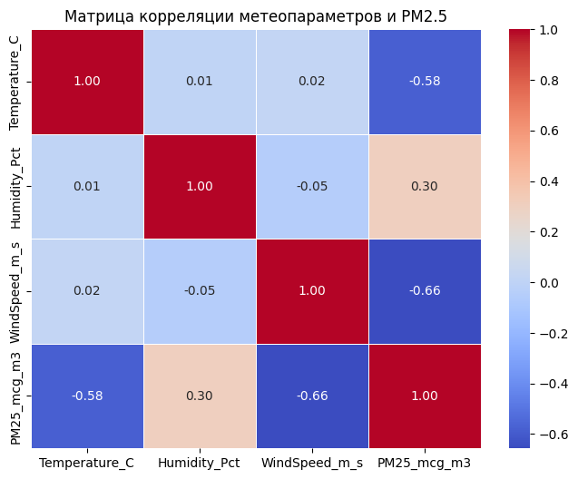
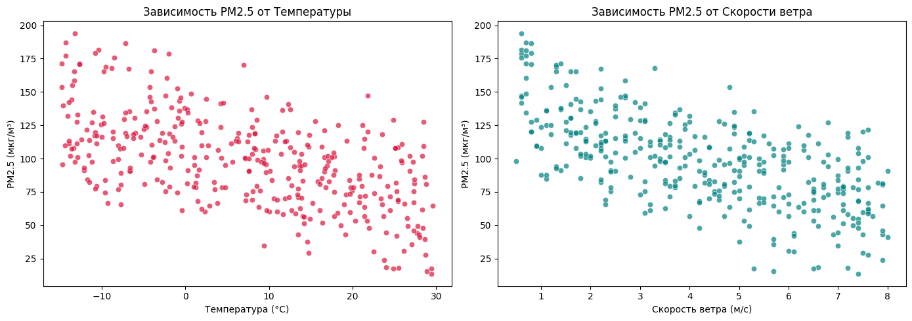
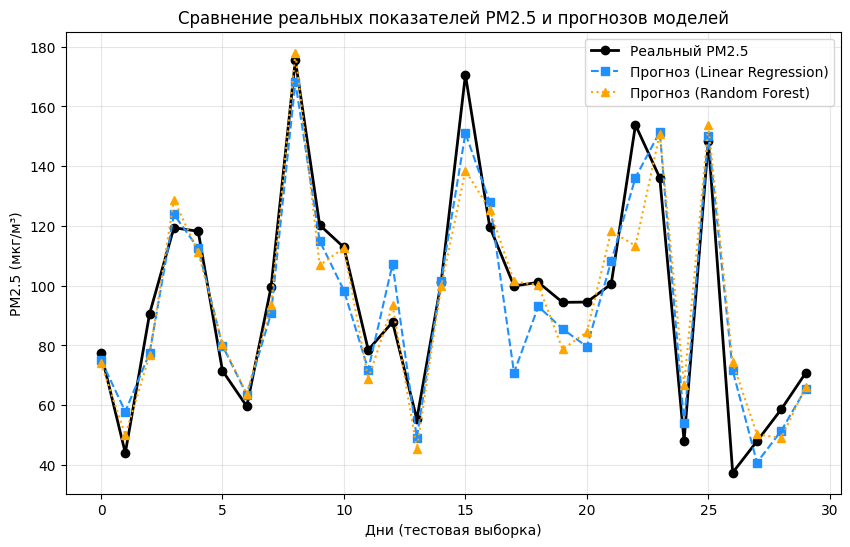

# Predictive Modeling of Air Quality ($PM_{2.5}$) in Almaty, Kazakhstan

## Overview
This repository contains a full-cycle computational research project focused on predicting daily $PM_{2.5}$ fine particulate matter concentrations in Almaty using standard meteorological indicators (Temperature, Relative Humidity, and Wind Speed). 

The goal of this project is to demonstrate how lightweight, zero-budget machine learning models can be deployed for early-warning urban air quality monitoring in Kazakhstan.

---

## Key Features & Methodology
- **Data Source:** Synthetic dataset calibrated against historical Almaty atmospheric trends ($N = 365$ daily observations).
- **Exploratory Data Analysis (EDA):** Evaluated feature correlations ($r$) between meteorological variables and $PM_{2.5}$ spikes.
- **Machine Learning Regressors:** Evaluated and compared **Linear Regression** and **Random Forest Regressor** ($n = 100$).
- **Documentation:** Full IMRaD academic paper generated using LaTeX.

---

## Quantitative Results

| Model | $R^2$ Score | RMSE ($\mu g/m^3$) | Key Takeaway |
| :--- | :---: | :---: | :--- |
| **Linear Regression** | **0.858** | **13.29** | Highest predictive accuracy; optimal for low-latency deployment. |
| **Random Forest** | 0.817 | 15.14 | Strong non-linear performance, slight overfit on extreme values. |

---

## Visualizations

### 1. Feature Correlation Matrix


### 2. Meteorological Relationships with $PM_{2.5}$


### 3. Model Predictions vs Actual Values


---

## Repository Structure
```text
├── Almaty_Air_Quality_Paper.pdf      # Complete academic research paper (IMRaD)
├── Almaty_Air_Quality_Research.ipynb # Google Colab notebook with full EDA & ML pipeline
├── correlation_matrix.png            # Feature correlation heatmap
├── scatter_plots.png                 # Meteorological relationship plots
├── predictions_comparison.png        # Model performance comparison chart
└── README.md                         # Project documentation
